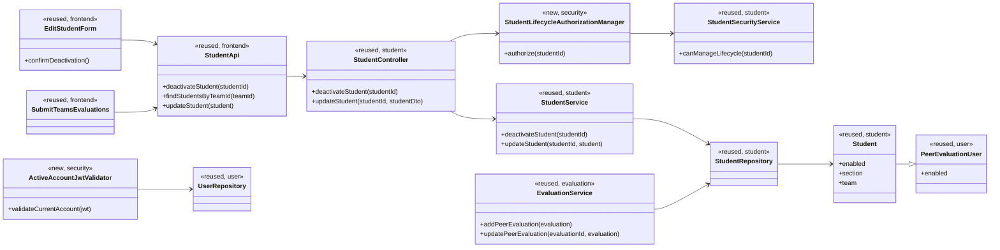

# Student (STU) Design

> Realizes: UC-STU-deactivate-student
> Depends on FRs: FR-SEC-authentication, FR-SEC-authorization, FR-SEC-deny-unauthorized, FR-SEC-active-account
> See: [Use Cases](../requirements/use-cases.md), [Business Rules](../requirements/business-rules.md), [Business Domain Model](../requirements/software-requirements-specification.md#business-domain-model), and [architectural-design.md](architectural-design.md) (Container and shared-foundation component views)
> Traces to: [GitHub issue #1](https://github.com/Flipperssss/add-a-use-case/issues/1)

## Overview

The student area owns the student account lifecycle over the shared foundation's course-section, team, and user model. Deactivation changes the existing account-level `enabled` state; it does not remove memberships or historical performance records. The SPA and REST API follow the shared containers and security conventions in the [architecture-of-record](architectural-design.md#building-block-view).

## Components & classes



- Reused frontend: [Students.vue](../../frontend/src/pages/students/Students.vue), [EditStudentForm.vue](../../frontend/src/pages/students/EditStudentForm.vue), and [student API](../../frontend/src/apis/student/index.ts).
- Reused backend: [StudentController](../../backend/src/main/java/team/projectpulse/student/StudentController.java), [StudentService](../../backend/src/main/java/team/projectpulse/student/StudentService.java), [StudentRepository](../../backend/src/main/java/team/projectpulse/student/StudentRepository.java), [Student](../../backend/src/main/java/team/projectpulse/student/Student.java), and [StudentSecurityService](../../backend/src/main/java/team/projectpulse/student/StudentSecurityService.java).
- New security wiring: `StudentLifecycleAuthorizationManager` under `security/authorizationmanagers/`, and `ActiveAccountJwtValidator` in `security/`; wire both through [SecurityConfiguration](../../backend/src/main/java/team/projectpulse/security/SecurityConfiguration.java).
- Reused login check: `MyUserPrincipal.isEnabled()` already prevents disabled accounts from completing Basic authentication; the new JWT check extends status enforcement to tokens issued before deactivation.
- Reused peer-evaluation path: [SubmitTeamsEvaluations.vue](../../frontend/src/pages/evaluations/SubmitTeamsEvaluations.vue) and [EvaluationService](../../backend/src/main/java/team/projectpulse/evaluation/EvaluationService.java). The frontend omits inactive students from new-target choices; the service enforces the same rule for direct API requests. The existing active-week and previous-ISO-week checks remain authoritative (`EvaluationService.requireOpenSubmissionWindow` via `WeekKeys.previousWeek(clock)`).

## Sequence

### Deactivate a student

```mermaid
sequenceDiagram
    actor A as Course admin / assigned instructor
    participant UI as EditStudentForm.vue
    participant API as StudentController
    participant Guard as StudentLifecycleAuthorizationManager
    participant Scope as StudentSecurityService
    participant Service as StudentService
    participant DB as StudentRepository

    A->>UI: Open student details (UC-STU-view-student)
    A->>UI: Choose Deactivate
    UI-->>A: Warn that account-wide access, including existing tokens, will stop
    UI-->>A: Explain that memberships and submitted work remain
    UI-->>A: Explain that inactive students cannot be new targets; existing evaluations remain editable by active evaluators until their window closes
    UI-->>A: Ask for confirmation (UC-STU step 4 and Associated Information)
    alt cancel before submitting
        A-->>UI: Cancel
        UI-->>A: Leave account unchanged; do not call API (UC-STU 4a)
    else confirm
        A->>UI: Confirm (UC-STU step 5)
        UI->>API: POST /api/v1/students/{studentId}/deactivate
        API->>Guard: Authorize caller for this student
        Guard->>Scope: Check course admin ownership or assigned-instructor membership
        alt missing student or unauthorized
            Scope-->>Guard: Deny
            Guard-->>API: 403
            API-->>UI: Generic authorization error (UC-STU 5b)
        else authorized
            Guard-->>API: Allow
            API->>Service: deactivateStudent(studentId)
            Service->>DB: Load student and set enabled=false
            Note over Service,DB: Preserve course-section/team links and existing work
            alt student already deactivated
                Service-->>API: No state change
                API-->>UI: 200 informational result (UC-STU 5a)
            else active student
                DB-->>Service: Save updated student
                Service-->>API: Deactivated
                API-->>UI: 200 success result (UC-STU step 6)
            end
            UI-->>A: Inform the actor; send no student notification
        end
    end
```

### Reject a new peer evaluation of an inactive student

```mermaid
sequenceDiagram
    actor E as Active student evaluator
    participant UI as SubmitTeamsEvaluations.vue
    participant StudentAPI as StudentController
    participant StudentService
    participant StudentDB as StudentRepository
    participant API as EvaluationController
    participant Service as EvaluationService
    E->>UI: Select peer-evaluation targets
    UI->>StudentAPI: GET /api/v1/students/teams/{teamId}
    StudentAPI->>StudentService: findStudentsByTeamId(teamId)
    StudentService->>StudentDB: Load current team members
    StudentDB-->>StudentService: Team members with current enabled status
    StudentService-->>StudentAPI: Team members
    StudentAPI-->>UI: Team members
    Note over UI: Omit inactive students from new-target choices; keep existing evaluation records visible
    E->>API: POST /api/v1/evaluations
    API->>Service: Validate evaluator, student target, and submission window
    Service->>StudentDB: Check target student account status
    alt target student inactive
        Service-->>API: Reject new evaluation
        API-->>UI: 400; no evaluation is stored
    else target student active
        Service-->>API: Save new evaluation
        API-->>UI: Success
    end
```

### Preserve edits to an existing evaluation

```mermaid
sequenceDiagram
    actor E as Active student evaluator
    participant UI as SubmitTeamsEvaluations.vue
    participant API as EvaluationController
    participant Service as EvaluationService
    participant DB as PeerEvaluationRepository
    E->>UI: Open an existing peer evaluation within its submission window
    UI-->>E: Show the saved evaluation, including a teammate now deactivated
    E->>UI: Edit and submit the existing evaluation
    UI->>API: PUT /api/v1/evaluations/{evaluationId}
    API->>Service: updatePeerEvaluation(evaluationId, evaluation)
    Service->>DB: Check the ordinary submission window and update the saved evaluation content
    DB-->>Service: Updated evaluation
    Service-->>API: Updated evaluation
    API-->>UI: Success
    Note over Service,DB: Keep evaluator, target, team, and week from the stored record; do not upsert or apply the new-target check
```

### Reject a previously issued token while its account is deactivated

```mermaid
sequenceDiagram
    actor S as Student or instructor with existing JWT
    participant API as Protected REST API request
    participant Validator as ActiveAccountJwtValidator
    participant DB as UserRepository
    S->>API: Request with previously issued JWT
    API->>Validator: Validate current account status
    Validator->>DB: Load current user status by JWT userId
    DB-->>Validator: enabled=false
    Validator-->>API: Reject authentication
    API-->>S: 401; controller is not invoked
```

## API contract

| Endpoint | Caller | Request | Success | Errors, by extension |
|---|---|---|---|---|
| `POST /api/v1/students/{studentId}/deactivate` (new) | Course admin owning the student's course or an instructor assigned to the student's course section | No body | `200 Result`; message distinguishes a state change from an already-deactivated no-op; no data payload | `403` for an unknown student or an unauthorized caller |
| `PUT /api/v1/students/{studentId}` (existing, narrowed) | Existing profile-edit callers; a course admin owning the course or instructor assigned to the course section for lifecycle status changes | Existing `StudentDto` | Existing `200 Result` and student data for profile edits and the existing reactivation path | Existing `404` for an unknown student; `403` for an unauthorized lifecycle caller; `409` for an active-to-disabled status change; use the lifecycle action instead |
| `POST /api/v1/users/login` (existing, reused) | User with credentials | Existing Basic-auth credentials | Existing user information and JWT for an enabled account | `401` if the account is deactivated |
| `POST /api/v1/evaluations` (existing, extended) | Active student evaluator | Existing peer-evaluation request | Existing `200 Result` | `400` if the target student is inactive; the service does not store a new evaluation |
| `PUT /api/v1/evaluations/{evaluationId}` (existing, preserved) | The active evaluator who owns the existing peer evaluation | Existing ratings/comment payload; evaluator, target, team, and week come from the stored evaluation | Existing `200 Result` when the ordinary submission window remains open, even if the target student is now deactivated; updates that record's content only | Existing `400` after the submission window closes; existing `403` for a non-owner; existing `404` if no evaluation exists |
| Any protected API request (authentication behavior changed) | Authenticated student or instructor | Existing Bearer JWT | Existing endpoint response if the current account is enabled | `401` on the next request while the account is deactivated or cannot be resolved |

## Key decisions

- **Use an explicit deactivation action.** The new `POST` action separates a confirmed account-lifecycle change from generic profile editing and gives repeated deactivation an informative no-op result. Reusing the generic `PUT` was rejected because it cannot distinguish an intentional lifecycle action from a profile update and would leave the confirmation flow implicit.
- **Enforce the lifecycle permission from persisted scope.** Resolve the target and authorize the authenticated caller against the student's persisted course or course-section relationship before changing account state; never accept caller-supplied scope. Permit the owning course admin or an instructor assigned to the student's course section, and fail closed with the same generic `403` for a missing student or an out-of-scope caller. A role-only instructor check was rejected because it would allow access across course sections and would not reliably admit the owning course admin.
- **Do not let generic profile updates deactivate an account.** Use a distinct confirmed action in the student form and route active-to-disabled transitions through the dedicated endpoint; reject that transition with `409` from the existing `PUT`. Lifecycle status changes through the existing `PUT`, including reactivation, must use the same persisted-scope authorization; unrelated profile editing and the rest of the reactivation flow remain governed by their existing use cases. Keeping the status toggle as an unrestricted deactivation path was rejected because it bypasses the dedicated confirmation, authorization, and informational no-op behavior.
- **Check account status for every protected request.** The shared check applies to student and instructor accounts: resolve the current persisted `enabled` status during JWT request authentication and reject a disabled or unresolved account before the controller. Do not treat a failed status lookup as enabled. A token denylist/version was rejected because it adds revocation state and schema; expiry-only revocation was rejected because it violates FR-SEC-active-account. This adds a user-status database read per protected request.
- **Keep existing data and memberships.** Reuse the account-level `enabled` field; do not delete, detach, or migrate student records. Removing the student from the course section or team was rejected because it would conflate account deactivation with membership administration and could sever historical context.
- **Separate new evaluation eligibility from existing evaluation editing.** Omit inactive students from new-target choices and reject a new submission targeting an inactive student, but let an active evaluator edit the existing record about that student until its normal window closes. The update path changes content only; evaluator, target, team, and week remain those stored on the record, and the path must not insert or upsert. Allowing an update to retarget an evaluation was rejected because it could bypass new-target eligibility. Freezing, hiding, or deleting existing evaluations was rejected because it would violate the preservation decision and BR-evaluation-editable-until-close.
- **Notify the actor only.** Show the outcome in the UI and send no deactivation email to the student. Student notification was rejected because the deactivation UC specifies an actor alert, while the reactivation UC separately and explicitly requires student notification.

## Data model

No table, column, or migration is added. Deactivation uses the existing account-wide `PeerEvaluationUser.enabled` field and preserves the existing `Student.section`, `Student.team`, `Activity`, and `PeerEvaluation` relationships in the SRS [Business Domain Model](../requirements/software-requirements-specification.md#business-domain-model).

## Reuse & cross-cutting

- Authentication and current-account enforcement reuse the shared `security` and `user` components and realize FR-SEC-active-account.
- Lifecycle authorization reuses the foundation's `AuthorizationManager` / `StudentSecurityService` pattern and realizes FR-SEC-authorization and FR-SEC-deny-unauthorized.
- Peer-evaluation submission-window behavior remains governed by BR-evaluation-editable-until-close and BR-evaluation-submission-window; only new submissions targeting an inactive student are rejected.
- No email integration is used for student deactivation.

## Tests

| Use case, flow | Level (unit / integration / Cypress) | Asserts |
|---|---|---|
| UC-STU-deactivate-student main success | Unit and integration | Authorized course admin and assigned instructor deactivate an active student; account becomes disabled, memberships and prior work remain, and the actor receives success |
| UC-STU-deactivate-student 4a cancel | Cypress | Cancel sends no deactivation request and leaves the account unchanged |
| UC-STU-deactivate-student 5a already deactivated | Unit and integration | Repeated request returns an informational success and does not change account or related records |
| UC-STU-deactivate-student 5b missing or unauthorized student | Integration | Unknown student, unrelated instructor, and student caller receive generic `403`; no state changes |
| FR-SEC-active-account disabled login | Integration | Basic authentication refuses deactivated student and instructor credentials with `401` |
| FR-SEC-active-account existing token | Integration | Student and instructor tokens acquired before deactivation are rejected with `401` on the next protected request |
| UC-EVA-submit-evaluation inactive student target | Unit and integration | A new evaluation targeting an inactive teammate is rejected and not stored; the UI omits the inactive student from new-target choices |
| UC-EVA-submit-evaluation existing evaluation after deactivation | Unit, integration, and Cypress | An active evaluator can update content on the existing record about a deactivated teammate; evaluator, target, team, and week remain unchanged, no additional record is created, and normal window closure still rejects edits |
| Generic student update bypass | Integration | `PUT /students/{studentId}` cannot deactivate an active account; lifecycle status changes through that route use the same persisted-scope authorization |

## Architecture delta

The shared security component gains a current-account-status check on every protected JWT request. The architecture-of-record's shared-foundation component description, Security & Compliance authentication text, and representative request sequence are updated to document the check and its `security` → `user` dependency. This changes no container boundary or data model; it realizes the already-specified FR-SEC-active-account.

## Open questions / risks

- The per-request account-status lookup adds a database read to each protected API request; no additional caching or token-version mechanism is proposed.
- The generic `403` for a missing student intentionally avoids disclosing whether the identifier exists.
- Deactivation applies to both an account's current and previously issued JWTs while disabled; reactivation restores account access under the existing token expiry policy.
- A new evaluation and deactivation may race; the requirements do not define a winner for simultaneous requests, so each operation checks current status within its transaction without adding a separate locking protocol.
